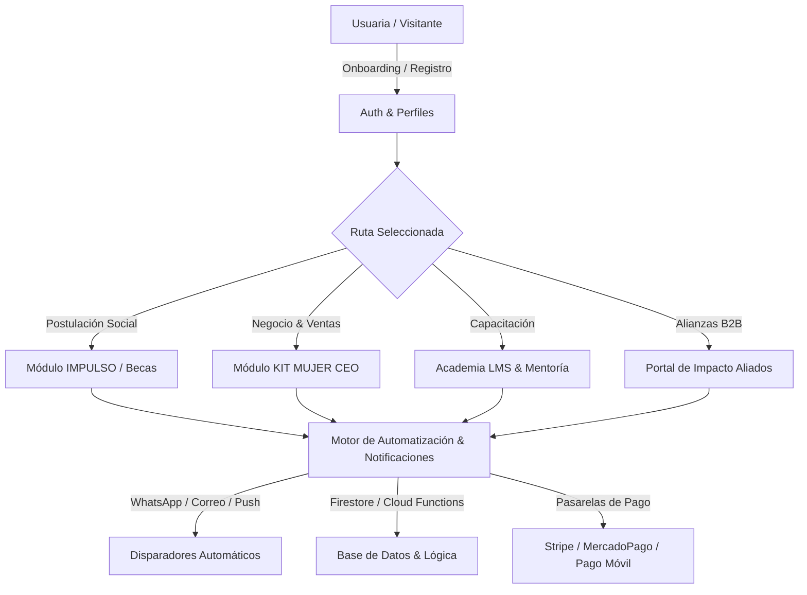

# 🚀 ESPECIFICACIÓN TÉCNICA DE MÓDULOS DE AUTOMATIZACIÓN
## Plataforma Integral Ecosistema Pariendo Ideas

> **Documento Maestro de Arquitectura Funcional y Automatización**  
> **Proyecto:** Pariendo Ideas | **Proyecto Firebase:** `pariendoideas-a5574`  
> **Versión:** 1.0.0 | **Fecha:** 22 de Agosto de 2026

---

## 📌 Tabla de Contenidos
1. [Visión General de la Automatización](#1-visión-general-de-la-automatización)
2. [Matriz de Módulos Funcionales a Desarrollar](#2-matriz-de-módulos-funcionales-a-desarrollar)
3. [Detalle de Módulos y Flujos de Automatización](#3-detalle-de-módulos-y-flujos-de-automatización)
   - [Módulo 1: Autenticación, Roles y Onboarding Inteligente](#módulo-1-autenticación-roles-y-onboarding-inteligente)
   - [Módulo 2: Programa IMPULSO (Renacer & Becas)](#módulo-2-programa-impulso-renacer--becas)
   - [Módulo 3: Kit Mujer CEO - E-Commerce Integrado](#módulo-3-kit-mujer-ceo---e-commerce-integrado)
   - [Módulo 4: Kit Mujer CEO - Punto de Venta (POS) Offline-Ready](#módulo-4-kit-mujer-ceo---punto-de-venta-pos-offline-ready)
   - [Módulo 5: Marketplace de Talento y Servicios Femeninos](#módulo-5-marketplace-de-talento-y-servicios-femeninos)
   - [Módulo 6: Academia Pariendo Ideas (LMS & Certificaciones)](#módulo-6-academia-pariendo-ideas-lms--certificaciones)
   - [Módulo 7: Motor de Mentorías 1:1 y Matchmaking](#módulo-7-motor-de-mentorías-11-y-matchmaking)
   - [Módulo 8: Eventos, P.I. Fest y Ticketing Digital](#módulo-8-eventos-pi-fest-y-ticketing-digital)
   - [Módulo 9: Comunidad, Círculos de Apoyo y Gamificación](#módulo-9-comunidad-círculos-de-apoyo-y-gamificación)
   - [Módulo 10: Centro de Recursos y Descargables](#módulo-10-centro-de-recursos-y-descargables)
   - [Módulo 11: Motor de Membresías, Suscripciones y Pagos](#módulo-11-motor-de-membresías-suscripciones-y-pagos)
   - [Módulo 12: Portal B2B para Aliados y Dashboard de Impacto](#módulo-12-portal-b2b-para-aliados-y-dashboard-de-impacto)
   - [Módulo 13: Motor de Notificaciones Multicanal y CRM WhatsApp](#módulo-13-motor-de-notificaciones-multicanal-y-crm-whatsapp)
   - [Módulo 14: Panel de Control y Super Admin CMS](#módulo-14-panel-de-control-y-super-admin-cms)
4. [Arquitectura Tecnológica e Integraciones](#4-arquitectura-tecnológica-e-integraciones)
5. [Plan de Ejecución por Sprints](#5-plan-de-ejecución-por-sprints)

---

## 1. Visión General de la Automatización

El objetivo de esta hoja de ruta es transformar la actual plataforma web de **Pariendo Ideas** en un ecosistema totalmente autónomo y transaccional, eliminando cuellos de botella manuales en admisiones, cobros, sincronización de ventas, agendamiento de mentorías, emisión de certificados y seguimiento psicosocial.



---

## 2. Matriz de Módulos Funcionales a Desarrollar

| # | Módulo | Objetivo Principal | Nivel de Automatización |
|---|---|---|---|
| **01** | **Auth & Onboarding** | Registro, verificación de identidad y perfilado por etapas. | 100% Automatizado |
| **02** | **IMPULSO (Renacer)** | Postulaciones a becas, scoring socioeconómico y seguimiento psicosocial. | 85% Automatizado |
| **03** | **Kit E-Commerce** | Creación de tiendas online, catálogo, checkout y control de inventario. | 95% Automatizado |
| **04** | **Punto de Venta (POS)** | Venta física rápida, recibos por WhatsApp y sync offline. | 90% Automatizado |
| **05** | **Marketplace B2C/C2C** | Directorio de servicios, cotizaciones y valoraciones con reviews. | 90% Automatizado |
| **06** | **Academia LMS** | Lecciones en video/guías, control de avance y certificados PDF con QR. | 100% Automatizado |
| **07** | **Motor de Mentorías** | Match inteligente mentora-alumna, calendario sincrónico y recordatorios. | 95% Automatizado |
| **08** | **Eventos & Ticketing** | Compra de entradas P.I. Fest, emisión de credenciales QR y check-in móvil. | 100% Automatizado |
| **09** | **Comunidad & Gamificación** | Círculos de apoyo, insignias por logros, muro de networking. | 80% Automatizado |
| **10** | **Resource Hub** | Descarga segura de plantillas, contratos y guías según nivel de membresía. | 100% Automatizado |
| **11** | **Billing & Subscriptions** | Cobros recurrentes, pasarelas locales/internacionales, facturación. | 100% Automatizado |
| **12** | **Portal Aliados B2B** | Métricas en tiempo real de impacto social para patrocinadores. | 95% Automatizado |
| **13** | **CRM WhatsApp & Push** | Disparo de mensajes transaccionales y secuencias de retención. | 100% Automatizado |
| **14** | **Super Admin CMS** | Gestión integral de usuarias, moderación, analíticas y tesorería. | 80% Automatizado |

---

## 3. Detalle de Módulos y Flujos de Automatización

### Módulo 1: Autenticación, Roles y Onboarding Inteligente
* **Funcionalidad:**
  * Autenticación con Firebase Auth (Google, Email/Contraseña y Magic Link vía WhatsApp).
  * Control de Roles: `EMPRENDEDORA`, `MENTORA`, `PSICOLOGA_FACILITADORA`, `ALIADO_B2B`, `SUPER_ADMIN`.
* **Automatizaciones:**
  * Detección de completitud de perfil (si < 80%, activa secuencia de recordatorios).
  * Asignación automática de acceso a la comunidad y catálogo según rol.
  * Generación automática de enlace único de tienda pública tras verificación.

---

### Módulo 2: Programa IMPULSO (Renacer & Becas)
* **Funcionalidad:**
  * Formulario dinámico de postulación a Beca de Reconstrucción (datos económicos, situación familiar, modelo de negocio).
  * Módulo de Bienestar Emocional: "Termómetro Semanal" (Check-in de estado de ánimo de 3 preguntas).
* **Automatizaciones:**
  * **Algoritmo de Scoring de Vulnerabilidad:** Pondera automáticamente las postulaciones (Rango 0 a 100) y clasifica en *Prioritaria*, *Evaluación* o *Derivación a Recursos Abiertos*.
  * **Alerta Temprana de Bienestar:** Si una emprendedora reporta puntaje crítico por 2 semanas consecutivas, se genera una notificación urgente para la psicóloga facilitadora.
  * **Aprobación de Beca:** Al ser aprobada por el comité, se activa automáticamente la suscripción gratuita, se crean los accesos al LMS y se le asigna su primera sesión de mentoría.

---

### Módulo 3: Kit Mujer CEO - E-Commerce Integrado
* **Funcionalidad:**
  * Generador de tienda online sin código (`pariendoideas.com/tienda/[nombre-negocio]`).
  * Catálogo de productos y servicios con variantes (talla, color, tipo).
  * Carrito de compras y pasarelas de pago (MercadoPago, Stripe, Pago Móvil / Zelle).
* **Automatizaciones:**
  * **Alerta de Stock Crítico:** Envía mensaje automático a la dueña cuando un producto tiene ≤ 3 unidades.
  * **Confirmación de Compra Inmediata:** Notificación vía WhatsApp/Email con detalle de pedido al comprador y vendedor.
  * **Conciliación de Pagos:** Confirmación automática de pagos digitales con actualización de estado a `PAGADO / EN_PREPARACION`.

---

### Módulo 4: Kit Mujer CEO - Punto de Venta (POS) Offline-Ready
* **Funcionalidad:**
  * Pantalla táctil de venta rápida optimizada para móvil y tablet.
  * Cobro en efectivo, tarjeta o transferencias rápidas.
  * Modo sin internet (IndexedDB local) con sincronización al reconectar.
* **Automatizaciones:**
  * **Envío de Recibo Digital:** Envío automático del ticket en formato PDF/imagen al WhatsApp del cliente final al cerrar la venta.
  * **Cierre de Caja Diario:** Resumen automatizado al final de la jornada con total vendido, métodos de pago y ganancia estimada.
  * **Sincronización en Segundo Plano:** En cuanto el dispositivo recupera señal de red, se suben las ventas locales a Firestore sin bloquear la UI.

---

### Módulo 5: Marketplace de Talento y Servicios Femeninos
* **Funcionalidad:**
  * Directorio centralizado de talento femenino en LATAM clasificado por categorías (Gastronomía, Moda, Tecnología, Salud, etc.).
  * Perfil público de la emprendedora con insignia de validación "Pariendo Ideas Verified".
  * Sistema de solicitud de cotizaciones y mensajería segura.
* **Automatizaciones:**
  * **Solicitud de Reseña:** 48 horas después de una venta o servicio concluido, se envía un mensaje automático al cliente para calificar y dejar reseña.
  * **Calculador de Reputación:** Actualización en tiempo real del rating promedio y medallas de desempeño (*Top Seller*, *Mentora Destacada*).

---

### Módulo 6: Academia Pariendo Ideas (LMS & Certificaciones)
* **Funcionalidad:**
  * Módulos de aprendizaje secuenciales (Ruta de Negocio, Finanzas para Emprendedoras, Marketing Digital, Bienestar).
  * Visualizador de video seguro, audios descargables y hojas de trabajo en PDF.
  * Evaluaciones y cuestionarios de validación por cada módulo.
* **Automatizaciones:**
  * **Desbloqueo Condicional:** Se desbloquea la siguiente lección únicamente al completar los cuestionarios mínimos (score ≥ 80%).
  * **Generador de Certificados:** Creación instantánea de Certificado Oficial en PDF con nombre de la graduada, firma digital y código QR único de verificación en blockchain/Firestore.
  * **Reactiva Alumnas Inactivas:** Si no ingresa en 7 días, se dispara un mensaje motivacional de rescate.

---

### Módulo 7: Motor de Mentorías 1:1 y Matchmaking
* **Funcionalidad:**
  * Directorio de mentoras con biografía, áreas de especialidad y disponibilidad horaria.
  * Integración con Google Calendar / Calendly para sincronización de slots en tiempo real.
* **Automatizaciones:**
  * **Smart Matching:** Sugiere las 3 mejores mentoras basándose en la etapa del negocio y la necesidad principal indicada por la emprendedora.
  * **Agendamiento y Creación de Sala Virtual:** Genera automáticamente el enlace de Google Meet o Zoom y lo envía a ambas agendas.
  * **Recordatorios Escalonados:** Aviso 24h y 1h antes de la sesión por WhatsApp.
  * **Formulario de Bitácora Post-Sesión:** Notificación a la mentora para registrar acuerdos y tareas acordadas con la alumna.

---

### Módulo 8: Eventos, P.I. Fest y Ticketing Digital
* **Funcionalidad:**
  * Cartelera de eventos virtuales, webinars y eventos presenciales (P.I. Fest anual).
  * Venta de tickets con múltiples niveles (General, VIP, Acceso a Rueda de Negocios).
* **Automatizaciones:**
  * **Emisión de Entrada con Código QR:** Al confirmarse el pago, se genera una credencial digital en el perfil y se envía por correo/WhatsApp.
  * **App de Acreditación / Check-in:** Escáner QR para administradoras en la puerta del evento con validación instantánea y prevención de duplicados.
  * **Encuesta de Satisfacción Post-Evento:** Envío automático de formulario NPS al terminar la transmisión o evento.

---

### Módulo 9: Comunidad, Círculos de Apoyo y Gamificación
* **Funcionalidad:**
  * Espacios de interacción por nicho (Círculo de Creadoras, Círculo de Servicios, etc.).
  * Muro social interactivo con opciones de compartir avances, buscar socias y celebrar hitos.
* **Automatizaciones:**
  * **Sistema de Puntos de Impacto (P.I. Coins):** Asignación automática de puntos por completar cursos, ayudar a otras emprendedoras o vender en el marketplace.
  * **Canje de Beneficios:** Conversión de puntos acumulados en descuentos para eventos o sesiones de mentoría adicionales.
  * **Moderación Inteligente:** Filtro automático de contenido inapropiado o spam mediante expresiones regulares y Cloud Functions.

---

### Módulo 10: Centro de Recursos y Descargables
* **Funcionalidad:**
  * Repositorio de plantillas en Excel (Flujo de caja, Costeo de recetas/productos, Inventarios).
  * Modelos de contratos legales estándar y kits de plantillas de Canva.
* **Automatizaciones:**
  * **Control de Permisos Dinámico:** Las descargas se habilitan automáticamente según el plan activo de la usuaria.
  * **Registro de Métricas de Descarga:** Contador de popularidad para retroalimentar al equipo sobre qué recursos son más demandados.

---

### Módulo 11: Motor de Membresías, Suscripciones y Pagos
* **Funcionalidad:**
  * Gestión de 3 niveles de membresía:
    1. *Semilla (Gratuito)*: Acceso a comunidad básica y recursos abiertos.
    2. *Despegue (Kit Mujer CEO)*: E-commerce, POS, Marketplace y 1 mentoría mensual.
    3. *Imperio (Aceleración VIP)*: Todo lo anterior + acceso prioritario a becas, eventos y mentoría ilimitada.
* **Automatizaciones:**
  * **Cobro Recurrente y Reintentos (Dunning):** Procesamiento automático mensual/anual; si falla la tarjeta, se realizan 3 reintentos antes de suspender el servicio.
  * **Generación de Comprobantes:** Envío de factura/recibo digital automático.
  * **Upgrades / Downgrades Instantáneos:** Ajuste inmediato de accesos al cambiar de plan sin fricción.

---

### Módulo 12: Portal B2B para Aliados y Dashboard de Impacto
* **Funcionalidad:**
  * Acceso privado para empresas patrocinadoras, ONGs e instituciones gubernamentales.
  * Vista analítica del impacto del capital aportado (número de becas activas, ingresos generados por las beneficiarias, horas de mentoría impartidas).
* **Automatizaciones:**
  * **Generador de Reportes de Sostenibilidad / ESG:** Exportación periódica automatizada en PDF con gráficas de impacto y testimonios anónimos de éxito.
  * **Alertas de Desembolso / Renovación:** Notificación al aliado cuando el fondo de becas alcanza el 80% de ejecución.

---

### Módulo 13: Motor de Notificaciones Multicanal y CRM WhatsApp
* **Funcionalidad:**
  * Motor centralizado de mensajería que orquesta:
    * WhatsApp Business API (Twilio / Meta Cloud API).
    * Notificaciones Push (Firebase Cloud Messaging - FCM).
    * Correos Transaccionales (SendGrid / Resend).
* **Automatizaciones:**
  * **Triggers basados en Eventos:** Cada acción en la plataforma (registro, compra, reserva, tarea pendiente) dispara su plantilla de mensaje optimizada.
  * **Canal Preferido:** Detección de si la usuaria prefiere WhatsApp o Correo, enviando por su canal más activo.

---

### Módulo 14: Panel de Control y Super Admin CMS
* **Funcionalidad:**
  * Vista centralizada 360° para el equipo directivo de Pariendo Ideas.
  * Gestión de usuarias, aprobación de postulaciones a becas y control de catálogo.
  * Dashboard financiero (GMV transaccionado, MRR de suscripciones, comisiones).
* **Automatizaciones:**
  * **Alertas de Negocio:** Notificación a directiva ante picos inusuales de tráfico, ventas récord o errores en pasarelas.
  * **Copia de Seguridad Automática:** Snapshot diario de base de datos Firestore y Storage a Cloud Storage frío.

---

## 4. Arquitectura Tecnológica e Integraciones

```
                      ┌───────────────────────────────────────────┐
                      │             NEXT.JS 16 (UI)               │
                      │  Tailwind CSS + Framer Motion + Shadcn UI │
                      └─────────────────────┬─────────────────────┘
                                            │
                      ┌─────────────────────▼─────────────────────┐
                      │          FIREBASE SERVICES LAYER          │
                      │ ┌───────────────────────────────────────┐ │
                      │ │ Firebase Auth (Identidad y Roles)     │ │
                      │ ├───────────────────────────────────────┤ │
                      │ │ Cloud Firestore (Base de Datos NoSQL) │ │
                      │ ├───────────────────────────────────────┤ │
                      │ │ Firebase Storage (Archivos & PDFs)    │ │
                      │ ├───────────────────────────────────────┤ │
                      │ │ Cloud Functions (Microservicios)      │ │
                      │ ├───────────────────────────────────────┤ │
                      │ │ Firebase Cloud Messaging (Push FCM)   │ │
                      │ └───────────────────────────────────────┘ │
                      └─────────────────────┬─────────────────────┘
                                            │
            ┌───────────────────────────────┼───────────────────────────────┐
            │                               │                               │
┌───────────▼───────────┐       ┌───────────▼───────────┐       ┌───────────▼───────────┐
│   PASARELAS DE PAGO   │       │   COMUNICACIÓN CRM    │       │    INTEGRACIONES      │
│ • Stripe              │       │ • WhatsApp Cloud API  │       │ • Google Calendar     │
│ • MercadoPago         │       │ • Resend / SendGrid   │       │ • Zoom / Google Meet  │
│ • Pago Móvil / Zelle  │       │ • Webhooks de Alertas │       │ • Generador PDF QR    │
└───────────────────────┘       └───────────────────────┘       └───────────────────────┘
```

---

## 5. Plan de Ejecución por Sprints

```mermaid
gantt
    title Plan de Desarrollo e Implementación de Módulos
    dateFormat  YYYY-MM-DD
    section Fase 1 - Core & Auth
    Setup Firebase Config & Auth Roles       :2026-09-01, 10d
    Módulo 1 Onboarding & Perfiles           :2026-09-11, 10d
    section Fase 2 - Negocio & POS
    Módulo 3 E-Commerce Básico               :2026-09-21, 14d
    Módulo 4 Punto de Venta (POS) Offline    :2026-10-05, 14d
    Módulo 5 Marketplace de Talento          :2026-10-19, 14d
    section Fase 3 - Impacto & Academia
    Módulo 2 Postulaciones IMPULSO & Becas   :2026-11-02, 14d
    Módulo 6 LMS & Certificados con QR       :2026-11-16, 14d
    Módulo 7 Motor de Mentorías 1:1          :2026-11-30, 12d
    section Fase 4 - Monetización & B2B
    Módulo 8 Ticketing Eventos P.I. Fest     :2026-12-12, 10d
    Módulo 11 Subscriptions & Facturación    :2026-12-22, 14d
    Módulo 12 Portal B2B Aliados             :2027-01-05, 12d
    Módulo 13 CRM WhatsApp & Notificaciones  :2027-01-17, 10d
    Módulo 14 Super Admin CMS                :2027-01-27, 14d
```

---

### 📝 Entregables Clave por Módulo
1. **Modelos de Datos Firestore (`collection/document`)** estandarizados y con reglas de seguridad estrictas (`firestore.rules`).
2. **Cloud Functions tipo Triggers:**
   - `onUserCreated`, `onOrderCreated`, `onScholarshipSubmitted`, `onMentorshipBooked`.
3. **Endpoints de API Seguros** en Next.js / Firebase con validación con `Zod`.
4. **Componentes React Reutilizables** con diseño responsivo, accesible y estético.

---
*Documento preparado y generado para el equipo de desarrollo del proyecto Pariendo Ideas.*
