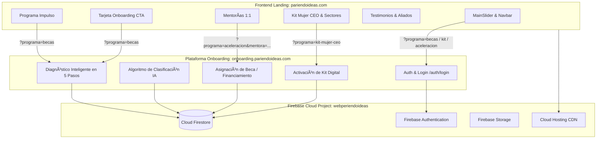

# 📋 Plan Maestro Integral de Desarrollo: Pariendo Ideas al 100%

> **Diagnóstico y Estado del Ecosistema (Septiembre 2026):**  
> La plataforma principal está desarrollada en Next.js 16 (Turbopack, Tailwind CSS v4, Framer Motion, Lucide Icons) y desplegada en producción en Firebase Hosting sobre el dominio principal `pariendoideas.com`.  
> Todas las secciones y llamados a la acción (CTAs) de la Landing Page han sido unificados y conectados directamente a la plataforma de diagnóstico y registro en **`https://onboarding.pariendoideas.com/`** mediante parámetros de ruta específicos.  
> Este documento detalla la arquitectura, el inventario de secciones activas, el estado de implementación y la hoja de ruta técnica para alcanzar la operatividad total del ecosistema digital.

---

## 1. 🔍 Auditoría de Estado: Implementado vs. Requerido

| Área / Componente | Estado Actual en Producción | Función & Destino en Onboarding |
|---|---|---|
| **Navbar & Cabecera** | ✅ 100% Activo y Responsive | Navegación suave y botón "Solicitar Beca" a `?programa=becas` (enlace "Iniciar sesión" ocultado por directriz comercial) |
| **Slider Principal (`MainSlider`)** | ✅ 100% Activo (3 slides rotativos) | Slide 1 ➔ `?programa=becas`<br>Slide 2 ➔ `?programa=kit-mujer-ceo`<br>Slide 3 ➔ `?programa=aceleracion` |
| **Hero Secundario** | ❌ Ocultado / Removido | Eliminado para evitar duplicidad de contenido con el `MainSlider` |
| **Marquesina de Herramientas (`TrustBar`)** | ✅ 100% Actualizado | Marquee con Google Cloud, Firebase, Cloudflare, WhatsApp Business, Radar, LandiaAI, Sellibri, Avila Pay, GoAgente IA, BBM Intelligent |
| **Módulos Core (`Modules`)** | ✅ 100% Vinculado | Tarjetas de Impulso (`becas`), Kit Mujer CEO (`kit-mujer-ceo`) y Aceleración (`aceleracion`) |
| **Programa Impulso (`ImpulsoProgram`)** | ✅ 100% Actualizado con nuevo copy | 3 submódulos + bloque "¿Cómo funciona?" con los 3 pasos hacia la optimización y financiamiento flexible |
| **Kit Mujer CEO (`KitMujerCEO`)** | ✅ 100% Actualizado | 3 Cuadros por etapas (Semilla, Temprana, Marketplace) + 8 Categorías + Red de Mujeres Líderes en Sectores Clave |
| **Precios y Membresías (`Pricing`)** | ✅ 100% Vinculado | Plan Semilla (`becas`), Plan Pro (`kit-mujer-ceo`) y Plan Elite (`aceleracion`) |
| **Mentorías 1:1 (`Mentorship`)** | ✅ 100% Activo e Interactivo | Carrusel con los 8 Mentores Oficiales (fotos de estudio, sin estrellas, nombres y especialidades oficiales) + agendamiento directo |
| **Tu Camino (`Journey`)** | ✅ 100% Actualizado | Los 4 pasos oficiales (Postulación, Diagnóstico, Aceleramiento con Kit CEO, Egreso con aval Cavecom-e) |
| **Historias que Inspiran (`Testimonials`)** | ✅ 100% Actualizado | Titular oficial de mujeres exitosas y resilientes + botones "Historias que inspiran" y "Únete ya" |
| **Aliados Estratégicos (`Allies`)** | ✅ 100% Actualizado (11 Aliados) | Tarjetas limpias (isotipo + nombre) de las 11 empresas aliadas, listas para carga de logotipos |
| **Llamado de Cierre (`ScholarshipCTA`)** | ✅ 100% Actualizado | Tarjeta oficial de Onboarding y Diagnóstico inteligente con IA que sustituye al formulario mock |
| **Eventos (`Events`)** | ⏸ Ocultado temporalmente | Ocultado por solicitud comercial para concentrar el tráfico en Onboarding |
| **Estadísticas de Impacto (`ImpactStats`)** | ⏸ Ocultado temporalmente | Ocultado por solicitud comercial para mantener la página ágil y directa |

---

## 2. 🔗 Mapeo Integral de Enlaces a la Plataforma de Onboarding

Todos los accesos están centralizados en [`src/lib/constants.ts`](file:///c:/Users/IAEGEA/Webpariendoideas/src/lib/constants.ts) apuntando a la plataforma `https://onboarding.pariendoideas.com`:

```
[PLATAFORMA ONBOARDING: https://onboarding.pariendoideas.com]
│
├── PROGRAMA BECAS E IMPULSO
│   └── /?programa=becas
│       ├── Botón "Solicitar Beca" (Navbar desktop y móvil)
│       ├── Slide 1 del Slider Principal
│       ├── Tarjeta "Programa IMPULSO" (Módulos)
│       ├── Submódulos "Psicosocial" y "Mentoría 1:1"
│       ├── Plan Semilla (Sección Pricing)
│       ├── Botón de Proceso ("Tres pasos para iniciar tu reconstrucción")
│       ├── Botón "Únete ya" (Historias que inspiran)
│       └── Tarjeta Principal de Onboarding (Sección Cierre Beca)
│
├── PROGRAMA KIT MUJER CEO
│   └── /?programa=kit-mujer-ceo
│       ├── Slide 2 del Slider Principal
│       ├── Tarjeta "Kit Mujer CEO" (Módulos)
│       ├── Plan Pro (Sección Pricing)
│       ├── Cuadro 1: Etapa Semilla (?programa=kit-mujer-ceo&etapa=semilla)
│       ├── Cuadro 2: Etapa Temprana (?programa=kit-mujer-ceo&etapa=temprana)
│       ├── Cuadro 3: Canales y Marketplace (?programa=kit-mujer-ceo&etapa=marketplace)
│       ├── 8 Categorías del Ecosistema (?programa=kit-mujer-ceo&sector=[sector])
│       ├── Red de Mujeres Líderes: Sectores Clave (Estilo de Vida, Producción, Servicios)
│       └── Botón "Cobrar en POS"
│
├── PROGRAMA ACELERACIÓN & MENTORÍAS
│   └── /?programa=aceleracion
│       ├── Slide 3 del Slider Principal
│       ├── Tarjeta "Aceleración Digital" (Módulos)
│       ├── Plan Elite (Sección Pricing)
│       ├── Botón "Comenzar aceleración" (Banner Matching de Mentorías)
│       └── Agendamiento directo por mentora:
│           ├── ?programa=aceleracion&mentora=carolina-perez
│           ├── ?programa=aceleracion&mentora=valentina-rodriguez
│           ├── ?programa=aceleracion&mentora=mariana-lopez
│           └── ?programa=aceleracion&mentora=daniela-torres
│
└── ACCESO ADMINISTRATIVO OCULTO (CMS)
    └── /gestor-pariendo-admin (Protegido con Google Auth / Firebase y lista blanca de correos)
```

---

## 3. 🏢 Directorio Oficial de Aliados Estratégicos

Las 11 organizaciones aliadas desplegadas en [`Allies.tsx`](file:///c:/Users/IAEGEA/Webpariendoideas/src/components/sections/Allies.tsx) en formato limpio para logotipos:

1. **Sellibri** (Comercio & Plataforma) — `/logosaliados/sellibri.png`
2. **Go Interaction Marketing** (Marketing & Crecimiento) — `/logosaliados/go-interaction.png`
3. **BBM Intelligent** (Sistemas Inteligentes & IA) — `/logosaliados/bbm-intelligent.png`
4. **Cocrea** (Arquitectura & Feng Shui) — `/logosaliados/cocrea.png`
5. **Disglobal** (Soluciones Comerciales) — `/logosaliados/disglobal.png`
6. **Dropanas** (Logística & Distribución) — `/logosaliados/dropanas.png`
7. **Benflor** (Desarrollo Productivo) — `/logosaliados/benflor.png`
8. **Renacer Contable** (Asesoría Financiera & Contable) — `/logosaliados/renacer-contable.png`
9. **Arte Medio W3** (Diseño & Creatividad Digital) — `/logosaliados/arte-medio-w3.png`
10. **BestWay Marketing** (Estrategia Digital) — `/logosaliados/bestway-marketing.png`
11. **Gold Stetic Clinic** (Salud Estética & Bienestar) — `/logosaliados/gold-stetic-clinic.png`

---

## 3.1 👥 Directorio Oficial de Mentoras y Mentores

Los 8 profesionales de la red desplegados en el carrusel de [`Mentorship.tsx`](file:///c:/Users/IAEGEA/Webpariendoideas/src/components/sections/Mentorship.tsx):

1. **Dra. Heidy Oropeza** — Médica y Asesora de Bienestar Integrativo (`/mentores/1.png`)
2. **Prof. Wolfan Bellorín** — Profesor de Oratoria y Locución (`/mentores/2.png`)
3. **Ing. Carlos Moreno** — Experto en Blockchain y Criptoactivos (`/mentores/3.png`)
4. **Lic. José Yván Bohórquez** — Experto en Inteligencia Artificial (IA) (`/mentores/4.png`)
5. **Lic. Celsa Perez** — Experta en Programación Neurolingüística (PNL) (`/mentores/5.png`)
6. **Lic. Soley Medina** — Licenciada en Contaduría y Finanzas (`/mentores/6.png`)
7. **Arq. Dioraisa Lo Martire** — Arquitecta Especialista en Diseño de Interiores y Feng Shui (`/mentores/7.png`)
8. **Abg. Wendy Méndez** — Abogada Especialista en Derecho Contractual (`/mentores/8.png`)

---

## 4. 🛠️ Arquitectura Técnica del Ecosistema



---

## 5. 📅 Hoja de Ruta para Operatividad al 100%

### Fase 1: Landing Page & Redirecciones (COMPLETADA ✅)
- [x] Corrección de DNS y despliegue sobre `pariendoideas.com` en Firebase Hosting.
- [x] Eliminación de bloques duplicados (`Hero`).
- [x] Centralización de URLs de Onboarding con parámetros dinámicos (`src/lib/constants.ts`).
- [x] Conexión de todos los botones y CTAs a `https://onboarding.pariendoideas.com/`.
- [x] Ocultamiento de módulos secundarios (`Events` e `ImpactStats`).
- [x] Ocultamiento de botones públicos de "Iniciar sesión" (Navbar, Footer, CTA).
- [x] Actualización de textos oficiales de Programa Impulso, Kit Mujer CEO, 4 Pasos de Tu Camino y Testimonios.
- [x] Carga y simplificación de los 11 Aliados Estratégicos (Sellibri corregido).
- [x] Actualización de la marquesina de herramientas tecnológicas integradas.
- [x] **Manejador de Contenido (CMS) en ruta oculta `/gestor-pariendo-admin`** con autenticación Google y permisos de administrador (`pariendoideass@gmail.com`).
- [x] Conexión reactiva en tiempo real de Slider Principal, Aliados y Marquesina al CMS vía Cloud Firestore.

### Fase 2: Gestión de Logotipos y Recursos Visuales (COMPLETADA ✅)
- [x] Generación y configuración oficial de tarjeta social OpenGraph / Twitter (`og-image.jpg`) para previsualizaciones en WhatsApp y redes.
- [x] Habilitación en el CMS de carga directa de URLs de logotipos oficiales (SVG / PNG) para los 11 aliados.
- [x] Soporte dinámico de fallback visual con isotipos de alta gama en [`Allies.tsx`](file:///c:/Users/IAEGEA/Webpariendoideas/src/components/sections/Allies.tsx).

### Fase 3: Sincronización Bidireccional con la Plataforma de Onboarding (EN CURSO 🔄)
- [x] Configuración de enlaces dinámicos con parámetros URL en la Landing (`?programa=...`, `&sector=...`, `&mentora=...`).
- [ ] Verificación de lectura de parámetros en `onboarding.pariendoideas.com` para preselección de flujo.
- [ ] Canal de retorno: Botón de regreso a la Landing o al Dashboard al culminar el diagnóstico.

### Fase 4: Portales Privados y Dashboards (COMPLETADA ✅)
- [x] **Portal de la Emprendedora (`/dashboard`):** Estado de postulación a beca (100% Otorgada), etapas de aceleración, acceso a Kit Mujer CEO y agenda de mentoría 1:1.
- [x] **Bandeja de Postulaciones en el CMS (`/gestor-pariendo-admin`):** Métricas en vivo de postuladas, filtros, aprobación de becas y botón directo de contacto por WhatsApp.
- [x] **Reglas de Seguridad Firestore (`firestore.rules`):** Blindaje de permisos de lectura y escritura restringido para `pariendoideass@gmail.com`.

---

*Última actualización: Septiembre 2026 — Desplegado y verificado en producción.*
