# 🌸 Pariendo Ideas — Plataforma Principal del Ecosistema Digital

> **Ecosistema Integral de Empoderamiento, Reconstrucción Productiva y Aceleración Digital para Mujeres Emprendedoras.**  
> **Dominio en Producción:** [https://pariendoideas.com](https://pariendoideas.com)  
> **Plataforma de Diagnóstico y Onboarding:** [https://onboarding.pariendoideas.com](https://onboarding.pariendoideas.com)  
> **Repositorio Oficial:** [https://github.com/gointeraction/PaginaPariendoideasNew](https://github.com/gointeraction/PaginaPariendoideasNew)

---

## 📋 Tabla de Contenidos

1. [Descripción General](#-1-descripción-general)
2. [Stack Tecnológico](#-2-stack-tecnológico)
3. [Arquitectura del Ecosistema](#-3-arquitectura-del-ecosistema)
4. [Especificación de Secciones de la Plataforma](#-4-especificación-de-secciones-de-la-plataforma)
5. [Mapeo de Enlaces y Parámetros a Onboarding](#-5-mapeo-de-enlaces-y-parámetros-a-onboarding)
6. [Portales Privados: Dashboard y Gestor CMS](#-6-portales-privados-dashboard-y-gestor-cms)
7. [Directorio Oficial de Mentores y Aliados](#-7-directorio-oficial-de-mentores-y-aliados)
8. [Sistema de Diseño y Guía de Estilo](#-8-sistema-de-diseño-y-guía-de-estilo)
9. [Matriz de Módulos de Automatización](#-9-matriz-de-módulos-de-automatización)
10. [Estructura del Proyecto](#-10-estructura-del-proyecto)
11. [Instalación, Ejecución y Despliegue](#-11-instalación-ejecución-y-despliegue)

---

## 🌟 1. Descripción General

**Pariendo Ideas** es una plataforma tecnológica diseñada para acompañar a mujeres líderes y emprendedoras desde la reconstrucción psicosocial y económica hasta la digitalización comercial, el comercio electrónico y la aceleración empresarial con inteligencia artificial y el respaldo de **Cavecom-e**.

El proyecto unifica tres pilares fundamentales:
- **Landing Page Interactiva y Reactiva (`/`)**: Conectada en tiempo real a **Cloud Firestore** para actualizar dinámicamente banners, aliados y herramientas tecnológicas sin necesidad de recompilar.
- **Portal de la Emprendedora (`/dashboard`)**: Panel de seguimiento de becas otorgadas, ruta de aceleración, activación del Kit Mujer CEO y agendamiento de mentorías 1:1.
- **Gestor Administrativo CMS (`/gestor-pariendo-admin`)**: Panel de control protegido con **Firebase Google Auth** para administrar el Slider Principal, Marquesina Tecnológica, Aliados Estratégicos, Galería Multimedia y Bandeja de Postulaciones en vivo.

---

## 🛠️ 2. Stack Tecnológico

| Categoría | Tecnología | Versión / Detalle |
|---|---|---|
| **Framework Frontend** | Next.js (App Router + Turbopack) | `^16.1.1` (Static Export / SPA Híbrido) |
| **Librería UI** | React + React DOM | `19.0.0` |
| **Lenguaje** | TypeScript | `^5` |
| **Estilos y Diseño** | Tailwind CSS v4 + `@tailwindcss/postcss` | `^4` |
| **Componentes Base** | Radix UI + shadcn/ui + Lucide Icons | Accesibles y personalizables |
| **Animaciones** | Framer Motion + Embla Carousel | `^12.23.2` / `^8.6.0` |
| **Backend Serverless** | Firebase (Auth, Firestore, Storage, Hosting) | `^12.18.0` (`webperiendoideas`) |
| **Estado y Formularios** | Zustand + React Hook Form + Zod | Gestión reactiva y validación |

---

## 🏗️ 3. Arquitectura del Ecosistema

```mermaid
graph TD
    subgraph Landing_PariendoIdeas [Frontend Principal: pariendoideas.com]
        LP1[Navbar & MainSlider Reactivo]
        LP2[Módulos Core & Programa IMPULSO]
        LP3[Kit Mujer CEO & Sectores Clave]
        LP4[Planes de Membresía & Mentorías 1:1]
        LP5[Comunidad, Tu Camino & Recursos]
        LP6[Testimonios, Aliados, FAQ & Beca CTA]
        DASH[Portal Emprendedora /dashboard]
        CMS[Gestor Admin CMS /gestor-pariendo-admin]
    end

    subgraph Subapp_Onboarding [Plataforma Onboarding: onboarding.pariendoideas.com]
        ON1[Autenticación & Registro]
        ON2[Diagnóstico Inteligente en 5 Pasos]
        ON3[Clasificación IA & Scoring de Beca]
        ON4[Activación de Kit Digital & Mentorías]
    end

    subgraph Backend_Firebase [Firebase Cloud Project: webperiendoideas]
        FB1[(Cloud Firestore)]
        FB2[Firebase Authentication]
        FB3[Firebase Storage]
        FB4[Firebase Hosting CDN]
    end

    LP1 -->|?programa=becas / kit-mujer-ceo / aceleracion| ON2
    LP2 -->|?programa=becas| ON2
    LP3 -->|?programa=kit-mujer-ceo&etapa=...| ON4
    LP4 -->|?programa=aceleracion&mentora=...| ON4
    LP6 -->|?programa=becas| ON2

    CMS <-->|Lectura/Escritura Tiempo Real| FB1
    CMS <-->|Subida de Imágenes| FB3
    CMS <-->|Google Auth Whitelist| FB2
    LP1 <-->|Suscripción onSnapshot| FB1
    DASH <-->|Estado de Postulación| FB1
```



---

## 🧩 4. Especificación de Secciones de la Plataforma

Todas las secciones se encuentran modularizadas en `src/components/sections/` y ensambladas en `src/app/page.tsx`:

| Orden | Sección | Componente | Estado | Especificación Funcional |
|---|---|---|---|---|
| **01** | **Barra de Navegación** | `layout/Navbar.tsx` | ✅ Activo | Header sticky con `backdrop-blur`, navegación suave por anclas (`#programas`, `#impulso`, `#kit-ceo`, `#precios`, `#mentoria`, `#comunidad`, `#aliados`) y CTA directo a **Solicitar Beca**. |
| **02** | **Slider Principal** | `sections/MainSlider.tsx` | ✅ Activo (CMS) | Carrusel hero rotativo de 3 slides sincronizado con Firestore (`cms/slider`):<br>1. *Reconstrucción Productiva y Becas*<br>2. *Kit Mujer CEO (E-Commerce + POS)*<br>3. *Aceleración Digital e IA con aval Cavecom-e* |
| **03** | **Marquesina Tecnológica** | `sections/TrustBar.tsx` | ✅ Activo (CMS) | Cinta continua de tecnologías que impulsan el ecosistema: *Google Cloud, Firebase, Cloudflare, WhatsApp Business, Radar, LandiaAI, Sellibri, Avila Pay, GoAgente IA, BBM Intelligent*. |
| **04** | **Módulos Core** | `sections/Modules.tsx` | ✅ Activo | Presentación ejecutiva de los 3 pilares: **Programa IMPULSO** (Becas y acompañamiento), **Kit Mujer CEO** (Herramientas comerciales) y **Aceleración Digital** (Escalamiento y mentoría). |
| **05** | **Programa IMPULSO** | `sections/ImpulsoProgram.tsx` | ✅ Activo | Detalla los 3 pilares de reconstrucción (*Acompañamiento Psicosocial, Reconstrucción Digital y Mentoría 1:1*) más el bloque **"¿Cómo funciona?"** en 3 pasos hacia la optimización y financiamiento flexible. |
| **06** | **Kit Mujer CEO** | `sections/KitMujerCEO.tsx` | ✅ Activo | Ecosistema tecnológico comercial dividido en:<br>• **3 Etapas:** *Semilla, Etapa Temprana y Canales/Marketplace*<br>• **8 Categorías del Ecosistema**<br>• **Red de Mujeres Líderes en Sectores Clave:** *Estilo de Vida, Producción y Servicios* |
| **07** | **Planes y Membresías** | `sections/Pricing.tsx` | ✅ Activo | Comparativa transparente de niveles:<br>• **Plan Semilla** (`?programa=becas`)<br>• **Plan Pro / Kit Mujer CEO** (`?programa=kit-mujer-ceo`)<br>• **Plan Elite / Aceleración** (`?programa=aceleracion`) |
| **08** | **Mentorías 1:1** | `sections/Mentorship.tsx` | ✅ Activo | Carrusel interactivo con los **8 Mentores Oficiales** de la red, especialidades verificadas y botón de agendamiento personalizado por mentor. |
| **09** | **Comunidad** | `sections/Community.tsx` | ✅ Activo | Círculos de apoyo, networking colaborativo entre fundadoras y espacios de crecimiento conjunto. |
| **10** | **Tu Camino (4 Pasos)** | `sections/Journey.tsx` | ✅ Activo | Hoja de ruta de la emprendedora:<br>1. *Postulación y Registro*<br>2. *Diagnóstico Inteligente con IA*<br>3. *Aceleramiento con Kit Mujer CEO*<br>4. *Egreso y Certificación con aval Cavecom-e* |
| **11** | **Historias que Inspiran** | `sections/Testimonials.tsx` | ✅ Activo | Casos de éxito y resiliencia de mujeres que transformaron sus negocios a través de Pariendo Ideas. |
| **12** | **Centro de Recursos** | `sections/Resources.tsx` | ✅ Activo | Guías descargables, plantillas financieras, kits legales y herramientas prácticas de gestión. |
| **13** | **Aliados Estratégicos** | `sections/Allies.tsx` | ✅ Activo (CMS) | Grid de las **11 empresas e instituciones aliadas** sincronizado en tiempo real con Firestore (`cms/allies`). |
| **14** | **Preguntas Frecuentes** | `sections/FAQ.tsx` | ✅ Activo | Acordeón interactivo resolviendo dudas sobre becas, requisitos de postulación, Kit Mujer CEO y certificaciones. |
| **15** | **Llamado de Cierre (Beca CTA)** | `sections/ScholarshipCTA.tsx` | ✅ Activo | Tarjeta de conversión final con acceso directo al **Diagnóstico Inteligente con IA** en la plataforma de Onboarding. |
| **16** | **Pie de Página** | `layout/Footer.tsx` | ✅ Activo | Enlaces institucionales, programas, contacto, redes sociales y derechos reservados. |
| **—** | *Hero Secundario / Eventos / ImpactStats* | `Hero.tsx`, `Events.tsx`, `ImpactStats.tsx` | ⏸ En Reserva | Componentes preservados en el código y desactivados en la vista principal por directriz comercial para maximizar la conversión hacia Onboarding. |

---

## 🔗 5. Mapeo de Enlaces y Parámetros a Onboarding

Centralizado en [`src/lib/constants.ts`](src/lib/constants.ts), cada llamado a la acción redirige a `https://onboarding.pariendoideas.com` con parámetros específicos para preconfigurar la experiencia de la usuaria:

```text
https://onboarding.pariendoideas.com
├── /?programa=becas
│   ├── Botón "Solicitar Beca" (Navbar desktop y móvil)
│   ├── Slide 1 del Slider Principal
│   ├── Tarjeta "Programa IMPULSO" (Módulos Core)
│   ├── Submódulos de Impulso y botón de 3 pasos
│   ├── Plan Semilla (Sección Precios)
│   ├── Botón "Únete ya" (Testimonios)
│   └── Tarjeta Principal de Cierre (ScholarshipCTA)
│
├── /?programa=kit-mujer-ceo
│   ├── Slide 2 del Slider Principal
│   ├── Tarjeta "Kit Mujer CEO" (Módulos Core)
│   ├── Plan Pro (Sección Precios)
│   ├── Etapas: &etapa=semilla | &etapa=temprana | &etapa=marketplace
│   ├── Sectores: &sector=[categoria]
│   └── Botón "Cobrar en POS" / Activar E-Commerce
│
└── /?programa=aceleracion
    ├── Slide 3 del Slider Principal
    ├── Tarjeta "Aceleración Digital" (Módulos Core)
    ├── Plan Elite (Sección Precios)
    ├── Banner de Matching de Mentorías
    └── Agendamiento por mentor: &mentora=[slug-del-mentor]
```

---

## 🔐 6. Portales Privados: Dashboard y Gestor CMS

### 6.1 Portal de la Emprendedora (`/dashboard`)
Ubicado en `src/app/dashboard/page.tsx`:
- Visualización del estado de postulación a la **Beca de Reconstrucción (100% Otorgada)**.
- Progreso por etapas dentro de la ruta de aceleración.
- Accesos directos a las herramientas del **Kit Mujer CEO** y sesiones de **Mentoría 1:1**.

### 6.2 Gestor Administrativo CMS (`/gestor-pariendo-admin`)
Ubicado en `src/app/gestor-pariendo-admin/page.tsx` y respaldado por `src/lib/cms-service.ts`:
- **Autenticación Segura:** Protegido con Firebase Google Auth y lista blanca de correos autorizados (`pariendoideass@gmail.com`).
- **Módulos de Administración:**
  - `ApplicationsManager.tsx`: Bandeja en tiempo real de postuladas desde el Onboarding, filtros por estado, aprobación de becas y contacto directo vía WhatsApp.
  - `SliderEditor.tsx`: Edición en vivo de títulos, subtítulos, textos de botones, enlaces e imágenes del Slider Principal.
  - `AlliesEditor.tsx`: Gestión de los 11 aliados estratégicos, categorías y carga de logotipos.
  - `TrustBarEditor.tsx`: Administración de las tecnologías mostradas en la marquesina.
  - `MediaManager.tsx` & `ImageUploader.tsx`: Subida de imágenes a Firebase Storage con compresión automática en cliente (WebP/PNG optimizado).

---

## 👥 7. Directorio Oficial de Mentores y Aliados

### 7.1 Red Oficial de Mentores (`Mentorship.tsx`)
1. **Dra. Heidy Oropeza** — Médica y Asesora de Bienestar Integrativo (`/Mentores/1.png`)
2. **Prof. Wolfan Bellorín** — Profesor de Oratoria y Locución (`/Mentores/2.png`)
3. **Ing. Carlos Moreno** — Experto en Blockchain y Criptoactivos (`/Mentores/3.png`)
4. **Lic. José Yván Bohórquez** — Experto en Inteligencia Artificial (IA) (`/Mentores/4.png`)
5. **Lic. Celsa Perez** — Experta en Programación Neurolingüística (PNL) (`/Mentores/5.png`)
6. **Lic. Soley Medina** — Licenciada en Contaduría y Finanzas (`/Mentores/6.png`)
7. **Arq. Dioraisa Lo Martire** — Arquitecta Especialista en Diseño de Interiores y Feng Shui (`/Mentores/7.png`)
8. **Abg. Wendy Méndez** — Abogada Especialista en Derecho Contractual (`/Mentores/8.png`)

### 7.2 Aliados Estratégicos (`Allies.tsx`)
1. **Sellibri** — Comercio & Plataforma (`/logosaliados/sellibri.png`)
2. **Go Interaction Marketing** — Marketing & Crecimiento (`/logosaliados/go-interaction.png`)
3. **BBM Intelligent** — Sistemas Inteligentes & IA (`/logosaliados/bbm-intelligent.png`)
4. **Cocrea** — Arquitectura & Feng Shui (`/logosaliados/cocrea.png`)
5. **Disglobal** — Soluciones Comerciales (`/logosaliados/disglobal.png`)
6. **Dropanas** — Logística & Distribución (`/logosaliados/dropanas.png`)
7. **Benflor** — Desarrollo Productivo (`/logosaliados/benflor.png`)
8. **Renacer Contable** — Asesoría Financiera & Contable (`/logosaliados/renacer-contable.png`)
9. **Arte Medio W3** — Diseño & Creatividad Digital (`/logosaliados/arte-medio-w3.png`)
10. **BestWay Marketing** — Estrategia Digital (`/logosaliados/bestway-marketing.png`)
11. **Gold Stetic Clinic** — Salud Estética & Bienestar (`/logosaliados/gold-stetic-clinic.png`)

---

## 🎨 8. Sistema de Diseño y Guía de Estilo

### Paleta de Colores
- **Primary (Púrpura):** `#A855F7`
- **Secondary (Rosa):** `#EC4899`
- **Accent (Naranja):** `#F97316`
- **Background:** `#FFFFFF`
- **Foreground:** `#2D2640`
- **Muted:** `#F5F3FF`
- **Border:** `#E9D5FF`

### Gradientes Institucionales
- **Gradient Primary:** `linear-gradient(to right, #A855F7, #EC4899, #F97316)`
- **Gradient Hero:** `linear-gradient(to bottom right, rgba(168,85,247,0.2), rgba(236,72,153,0.1), rgba(249,115,22,0.2))`

### Componentes y Microinteracciones
- **Botones Primarios:** `rounded-full gradient-primary text-white shadow-md hover:opacity-90`
- **Tarjetas:** `rounded-3xl border bg-card hover:shadow-xl hover:-translate-y-1 transition-all duration-300`
- **Badges:** `rounded-full bg-purple-100 text-purple-700`

---

## ⚙️ 9. Matriz de Módulos de Automatización

El ecosistema completo de **Pariendo Ideas** abarca 14 módulos funcionales documentados en [`MODULOS_AUTOMATIZACION_PARIENDO_IDEAS.md`](MODULOS_AUTOMATIZACION_PARIENDO_IDEAS.md):

| # | Módulo | Objetivo Principal | Nivel de Automatización |
|---|---|---|---|
| **01** | **Auth & Onboarding** | Registro, verificación de identidad y perfilado por etapas. | 100% Automatizado |
| **02** | **IMPULSO (Renacer)** | Postulaciones a becas, scoring socioeconómico y seguimiento psicosocial. | 85% Automatizado |
| **03** | **Kit E-Commerce** | Creación de tiendas online, catálogo, checkout y control de inventario. | 95% Automatizado |
| **04** | **Punto de Venta (POS)** | Venta física rápida, recibos por WhatsApp y sincronización offline. | 90% Automatizado |
| **05** | **Marketplace B2C/C2C** | Directorio de servicios femeninos, cotizaciones y valoraciones. | 90% Automatizado |
| **06** | **Academia LMS** | Lecciones en video/guías, control de avance y certificados con QR. | 100% Automatizado |
| **07** | **Motor de Mentorías** | Match inteligente mentora-alumna, calendario sincrónico y recordatorios. | 95% Automatizado |
| **08** | **Eventos & Ticketing** | Entradas P.I. Fest, emisión de credenciales QR y check-in móvil. | 100% Automatizado |
| **09** | **Comunidad & Gamificación** | Círculos de apoyo, insignias por logros y muro de networking. | 80% Automatizado |
| **10** | **Resource Hub** | Descarga segura de plantillas, contratos y guías según membresía. | 100% Automatizado |
| **11** | **Billing & Subscriptions** | Cobros recurrentes, pasarelas locales/internacionales y facturación. | 100% Automatizado |
| **12** | **Portal Aliados B2B** | Métricas en tiempo real de impacto social para patrocinadores. | 95% Automatizado |
| **13** | **CRM WhatsApp & Push** | Disparo de mensajes transaccionales y secuencias de retención. | 100% Automatizado |
| **14** | **Super Admin CMS** | Gestión integral de usuarias, contenidos, moderación y analíticas. | 80% Automatizado |

---

## 📁 10. Estructura del Proyecto

```text
Webpariendoideas/
├── public/
│   ├── Mentores/                  # Fotografías oficiales de los 8 mentores
│   ├── logosaliados/              # Logotipos de las 11 organizaciones aliadas
│   ├── og-image.jpg               # Tarjeta OpenGraph / WhatsApp preview
│   └── logopariendoideas.png      # Identidad visual oficial
├── src/
│   ├── app/
│   │   ├── dashboard/             # Portal privado de la emprendedora (/dashboard)
│   │   ├── gestor-pariendo-admin/ # Panel administrativo CMS (/gestor-pariendo-admin)
│   │   ├── globals.css            # Estilos globales y tokens Tailwind v4
│   │   ├── layout.tsx             # Metadatos SEO, OpenGraph y fuentes
│   │   └── page.tsx               # Ensamblaje principal de la Landing Page
│   ├── components/
│   │   ├── admin/                 # Módulos del CMS (Slider, Aliados, Postulaciones, Media)
│   │   ├── layout/                # Navbar, Footer y utilidades de scroll
│   │   ├── sections/              # Todas las secciones de la Landing Page
│   │   └── ui/                    # Componentes reutilizables shadcn/ui + Radix
│   └── lib/
│       ├── cms-service.ts         # Servicios reactivos de Firestore y Storage
│       ├── constants.ts           # Rutas centralizadas hacia Onboarding
│       ├── firebase.ts            # Inicialización de Firebase Client SDK
│       └── utils.ts               # Helpers de clases y formato
├── firebase.json                  # Configuración de Firebase Hosting y Firestore
├── firestore.rules                # Reglas de seguridad de Cloud Firestore
├── next.config.ts                 # Configuración de Next.js (output: export)
└── package.json                   # Scripts y dependencias del proyecto
```

---

## 🚀 11. Instalación, Ejecución y Despliegue

### Prerrequisitos
- **Node.js** `>= 20.x` (o **Bun**)
- **Firebase CLI** (`npm install -g firebase-tools`) para despliegues en producción

### 1. Clonar el repositorio e instalar dependencias
```bash
git clone https://github.com/gointeraction/PaginaPariendoideasNew.git
cd PaginaPariendoideasNew
npm install
```

### 2. Variables de Entorno (`.env`)
El proyecto utiliza las credenciales públicas del proyecto de Firebase `webperiendoideas`:
```env
NEXT_PUBLIC_FIREBASE_API_KEY="AIzaSy..."
NEXT_PUBLIC_FIREBASE_AUTH_DOMAIN="webperiendoideas.firebaseapp.com"
NEXT_PUBLIC_FIREBASE_PROJECT_ID="webperiendoideas"
NEXT_PUBLIC_FIREBASE_STORAGE_BUCKET="webperiendoideas.firebasestorage.app"
NEXT_PUBLIC_FIREBASE_MESSAGING_SENDER_ID="109062625799"
NEXT_PUBLIC_FIREBASE_APP_ID="1:109062625799:web:95ee00f31db1e6da6328a2"
NEXT_PUBLIC_FIREBASE_MEASUREMENT_ID="G-L189E1NDVR"
```

### 3. Ejecutar servidor de desarrollo local
```bash
npm run dev
```
- **Landing Principal:** `http://localhost:3000`
- **Portal Emprendedora:** `http://localhost:3000/dashboard`
- **Gestor Admin CMS:** `http://localhost:3000/gestor-pariendo-admin`

### 4. Compilar y desplegar en producción (Firebase Hosting)
```bash
# Generar build estático en la carpeta /out
npm run build

# Compilar y desplegar directamente a Firebase Hosting
npm run deploy
```

---

© **Pariendo Ideas** — *De la resiliencia al liderazgo empresarial.*
